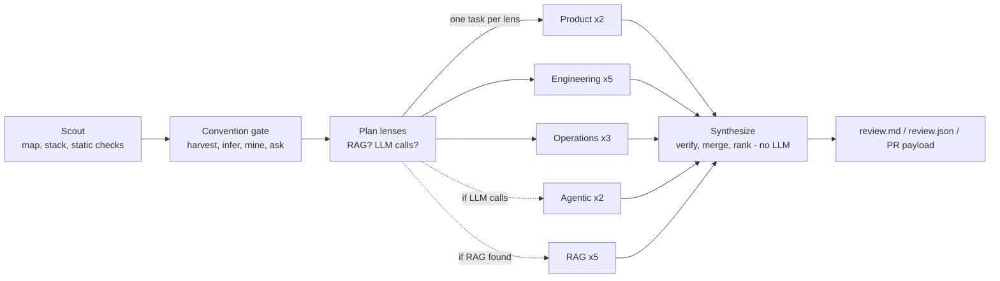

# code-review-agents

A convention-aware, multi-agent code reviewer. Point it at a repo (or a PR) and it:

1. **scouts** the repo once (file map, stack, static checks, structure metrics, whether a RAG pipeline or an LLM tool-loop exists),
2. **harvests team conventions** and asks a human only about what it cannot read,
3. **fans out specialist lens agents in parallel** across three always-on dimensions:
   - **product**: objective & fit, approach & architecture
   - **engineering quality**: design patterns & abstractions, extensibility & modularity, robustness & error handling, maintainability & readability, testing & observability
   - **operations**: scalability & cost, accuracy & correctness, security, privacy & governance

   plus LLM/agent and RAG packs that run only when the scout finds evidence for them,
4. **synthesizes** one review in plain code: verifies every evidence anchor, merges duplicates, surfaces tradeoffs, ranks,
5. writes a review document (high-level verdict first, then specific comments per lens), a JSON, and a GitHub PR review payload.

Design rationale and the full feature list: [DESIGN.md](DESIGN.md). A real run is in [examples/battery-perf-analysis](examples/battery-perf-analysis).



## Install and run

```bash
cd code-review-agents
python -m venv .venv && source .venv/bin/activate
pip install -e ".[dev]"
export ANTHROPIC_API_KEY=...            # needed only for --runner anthropic (the default)

cra review owner/repo --out review-out                 # shallow-clones, reviews, writes 4 files
cra review . --gate interactive --profile .cra/profile.json   # asks about ambiguous conventions, remembers answers
cra review . --base origin/main --pr owner/repo#12     # PR mode; dry run: writes a payload mapped to the PR's diff lines
cra review . --base origin/main --pr owner/repo#12 --post     # actually posts the review
cra review . --mine-history owner/repo                 # learn conventions from merged-PR review comments
cra lens-prompt accuracy .                             # inspect exactly what a lens is told and shown
cra baseline .                                         # repo with no PR: local branches that make every file reviewable
```

No API key? Use recorded findings: `cra review . --runner replay --replay-dir examples/battery-perf-analysis/lens_findings`.

## Team conventions

Declared sources are read automatically (`.review-rules.yaml`, `REVIEW.md`/`CLAUDE.md`/`CONTRIBUTING.md` bullets, `pyproject.toml`, `.flake8`, `.editorconfig`, `.pre-commit-config.yaml`, `package.json`, `tsconfig.json`, `CODEOWNERS`). See [examples/review-rules.example.yaml](examples/review-rules.example.yaml). Rules enforced by a linter are never commented on.

Inferred conventions are only candidates. In CI (`--gate auto`) nothing is asked and they stay `unconfirmed` (capped at nit). To confirm, put answers in a file and run `--gate answers --answers answers.yaml`:

```yaml
batch-consistent: enforce      # the "followed almost everywhere" question
q-logging: ignore
"*": skip                      # default for anything else
```

## Layout

```
src/code_review_agents/
  scout/        snapshot, stack, topology (RAG/LLM detection), structure (complexity, coupling, cycles), redact, static_checks
  conventions/  harvest (declared + inferred), history (PR mining), gate (questions, answers, cache)
  lenses/       catalog (17 lens prompts in 5 dimensions), context pack, read-only tools, runners
  synthesis/    merge: anchors, suppressions, layering, dedupe, conflicts, ranking
  render/       review.md
  github/       diff-line mapping, review payload, posting, baseline branches
  graph.py      LangGraph orchestration      cli.py / api.py   entry points
tests/          100 tests; no network or API key needed
```

## Tests

```bash
pytest
```

The Anthropic tool-loop is tested against a scripted fake client, the GitHub poster against a fake `gh`, everything else against real temporary git repos.

## Known limits

- **The lens agents have not been run against the live Anthropic API.** `AnthropicLensRunner` is unit-tested with a scripted client only. Its first live run may surface API details (tool-schema acceptance, whether a newer model rejects `temperature`; pass `temperature=None` if so). Lens quality (precision/recall) has not been measured; see DESIGN.md for the eval plan.
- Convention *inference* and structure metrics cover Python only; declared-config harvesting also covers JS/TS configs.
- The engineering-lens prompts (design patterns, extensibility, robustness, maintainability) are new and unevaluated.
- The RAG lens prompts have not been exercised on a real RAG repo.
- Merge thresholds (title/claim similarity 0.30 near the same lines, 0.65 anywhere) are untuned.
